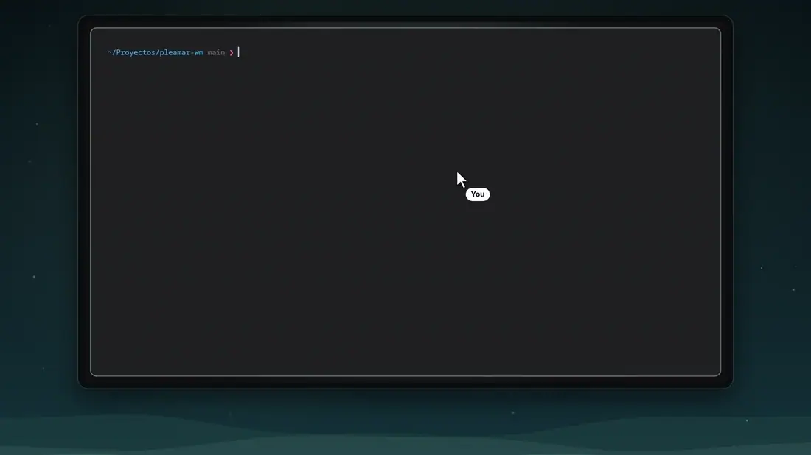
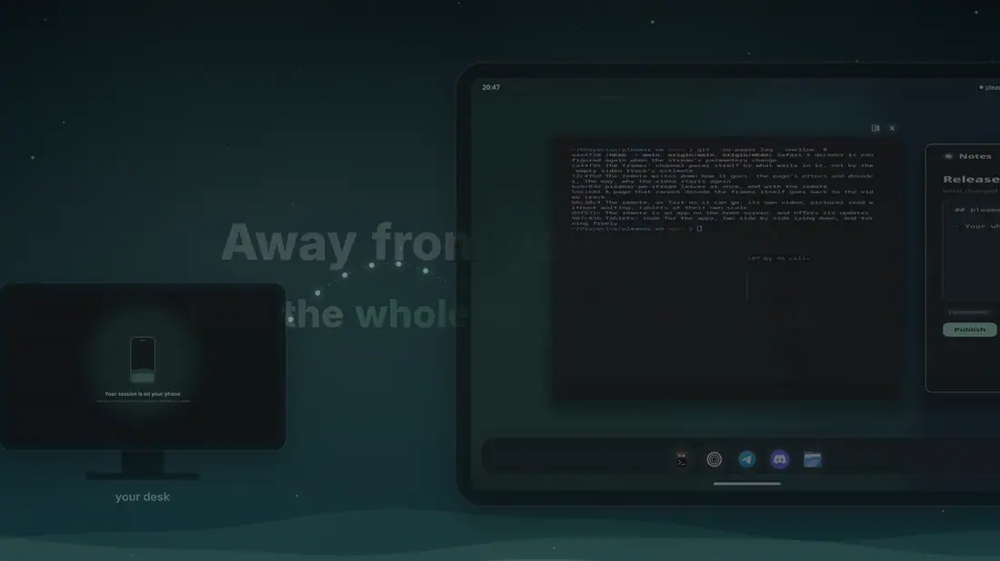

<div align = center>


<br>

[![Badge License]][License]
![Badge Language]
![Badge Commit]
[![Badge Issues]][Issues]
[![Badge Discord]][Discord]
[![Badge X]][X]
[![Badge Ko-fi]][Ko-fi]

<br>

pleamar-wm is a Wayland compositor whose window manager is a [pleamar] scene:
where windows go, how they arrive, how they leave and how they are dragged is
springs, rules and zones in a file you can rewrite — and saving it re-lays out
the open windows without closing anything.

<br>

---

**[<kbd> <br> Install <br> </kbd>][Install]**
**[<kbd> <br> Configure <br> </kbd>][Configure]**
**[<kbd> <br> Keys <br> </kbd>][Keys]**
**[<kbd> <br> pleamar <br> </kbd>][pleamar]**
**[<kbd> <br> Marea <br> </kbd>][Marea]**
**[<kbd> <br> Discord <br> </kbd>][Discord]**

---

<br>

</div>

# What's new

- **Wires: agents that work together** (0.5): on a free monitor, drag the drop at
  the start of a window's title bar to another window and the two are wired
  —a current of water between them; the mouse over its middle names it («tests», «frontend») or cuts it—. Tiled, wires stay: each window says in the gap above it what it is wired to, and the ones wired to the window under the mouse light up. The
  wire is the person's word: an agent in one terminal (Claude Code, Codex,
  any with a shell) may then read the other, type in it and hand it tasks
  with `pleamar-wm link`: `whoami`, `list`, `label N NAME`, `read N`, `send N TEXT --enter`,
  `keys N enter`, `wait N`, `ask N` and `answer N 2` —what the agent there asks its person (a permission, a choice, a yes/no) and an answer to it, by number, by the words of an option or as free words where it lets you type; the window says who answered—, and `delegate N TASK` —the task goes in as a
  paste with a line that says where it comes from, a drop of light runs
  along the wire while it is worked on, and the answer comes back: printed
  with `--wait`, or typed into the asking agent's terminal when it is done; a
  question it stops to ask on the way comes back the same way—.
  Each window with an agent says in its title bar what it is and where, and
  whether it works, is ready or waits for you (its edge goes amber); zoomed
  out, a canvas shows it big over each window, and one waiting out of sight
  leaves a drop at the monitor's edge that takes the camera there.
- **The canvas comes back** (0.5): while a session runs, its terminals on
  free monitors are kept —their program, their folder, the agent in each,
  their place on the plane—, with the wires between them and each camera.
  The next session offers «Bring back your canvas»: each terminal opens
  again in its folder and place, its agent starts again on its last
  conversation (`claude --continue`, `codex resume --last`), and the wires
  are drawn again with their names. Kept in `~/.local/state/pleamar-wm`.
- **Agents that know about wires** (0.5): `pleamar-wm link setup` (it says
  what it changes and asks) installs a skill for Claude Code and Codex,
  registers `pleamar-wm link mcp` as their MCP server —tools of their own
  (`link_delegate`, `link_ask`, `link_answer`, `link_spawn`…), and on start
  they are told which window they are and what is wired to them— and adds
  Claude Code's hooks, which tell its terminal exactly how it is and its last
  answer. `link spawn codex "TASK"` opens a terminal with that agent beside
  yours, wired, and hands it the task. `link setup --undo` takes it away.
- **Terminals with a name, for your shell**: `pleamar-wm link open --name
  Prohard --folder ~/Proyectos --quiet claude --model claude-opus-5-5` opens a
  terminal of its own —beside nobody's, wired to nobody— in that folder,
  types the command into its shell and prints its window's number. The name
  is in its environment (`PLEAMAR_NAME`, which what runs there inherits), its
  layer tells it (`name` in `term info`) and the scene has it as `who.N`, so a
  shell knows that window is that companion of yours wherever it goes. A named
  terminal is its namer's to bring back: the kept canvas leaves it out.
- **A mailbox for each named terminal**: `pleamar-wm link post Prohard look at
  issue 38` leaves a letter for the agent in the terminal named so, and the
  session hands it over when that agent is free —at rest, asking nothing, its
  person not halfway through writing to it—, one at a time and in order, then
  keeps what it answered. Nobody has to wait for it or own a window: a shell's
  finder, a routine or another agent (`--from Planipro`) can post, and a letter
  for a name with no terminal yet waits for one. `link mail [NAME] [--json]`
  says what waits, what each is at and its last answers; `--pause`,
  `--resume`, `--first ID` and `--cancel ID` change the order. Mailboxes are
  kept across sessions (`$XDG_STATE_HOME/pleamar-wm/mail`), and the scene's
  `mail.seq` changes whenever one does.
- **A gate for what agents ask to do**: `pleamar-wm gate setup` puts it in
  Claude Code and Codex (their `PermissionRequest` hook) and opencode (a
  plugin). What an agent would ask its person then stops for real until it is
  decided: by the person's rules (`gate.rules` beside the session's
  configuration, `deny|allow WHO TOOL WHAT` a line, denials first; a broken
  line denies everything), or by the person from their shell (`gate list
  --json`, `gate answer ID allow|deny`). A shell that answers says so in the
  scene (`gate.listen`); with none, or no answer in 90 s, or outside a
  session, the agent asks on its own screen as ever. Every decision is written
  down before it is told (`gate log`, secrets hidden), and the scene's
  `gate.seq` changes whenever a request comes or goes.
- **The session's agents, for your shell**: `pleamar-wm agents --json` lists
  every window with an agent —its number, agent, folder and whether it works,
  is ready or asks— and, asking, the question with its options by number and
  a key, one JSON object a line. `agents answer N OPTION --key KEY` answers
  only if that same question is still on the screen (otherwise nothing is
  sent, exit 3), and `agents stop N` sends Ctrl+C. Unlike `link`, it needs no
  wire: it speaks for the person, so a bar can show and answer what agents
  ask. `--log FILE --by WHO --class A|B|C` keeps a line of each answer,
  refusal or stop, with secrets hidden.
- **Every terminal readable and writable from outside** (0.5): in a session,
  the terminals it starts —kitty, Alacritty, foot, Konsole, any that runs
  `$SHELL`— run the user's shell through a thin layer of pleamar-wm's own,
  which passes everything through untouched and keeps what is on the screen.
  `pleamar-wm term list` shows them (which window, what runs in each: an
  agent such as Claude Code, and whether it works or waits for you, its
  folder); `term read ID`, `term paste ID TEXT`, `term keys ID enter` read
  and type in one, wherever it is and whether it has the keyboard or not.
  What runs inside knows its terminal by `PLEAMAR_TERMINAL`. A command run
  with `$SHELL -c`, or anything not on a terminal, gets the shell as it is;
  `terminals off` in session.conf leaves them all as they are.
- **Free is a canvas** (0.5): a free monitor's windows live on a plane with
  no edges, seen through a camera, as an infinite whiteboard of windows. Super
  and a drag on the empty plane to move about, Super and the wheel (over the plane
  or a window) to come closer or go further right where the pointer is, `Super+0`
  to see them all, and Super and a double click on a window brings it to the middle. Each program keeps its own size and is shown smaller when
  the camera is further away; let a window go near another one's edge and it
  takes its side, or against the monitor's edge and it takes that half or
  quarter of what is seen. `Super+W` as ever; also the last tile of the
  layouts strip, the control centre, or `layout DP-3 free` in session.conf.
- **A shore that behaves as you say** (0.5): the control centre has a Dock page
  —hidden until the mouse touches its edge (windows take its room meanwhile),
  magnified under the mouse as macOS's, without the drops under open programs,
  windows put away into their icon, four sizes, and its edge: bottom, left or
  right—, applied at once and kept in session.conf (`dock-style`). Right click
  on an icon: its windows, a new window, hide them, keep it or let it go, close
  them; and while its program starts, the icon hops.
- **Eight layouts, and one control centre to pick them** (0.4): to the leader,
  columns, rows and grid come **scrolling** (as niri: columns on a strip that
  glides to the one with the keyboard), **marea** (the one with the keyboard
  widest, and each one wider the more you use it) and **fractal** (each window
  a box that is split and split again —a new one halves the one you are on, one
  let go near another's edge docks there, one let go in another's middle makes
  a group with it: a small screen of their own in that box— and a camera that
  zooms into any of them and out to see them all, Super and the wheel right
  where the pointer is). `pleamar-wm control` (Super+I) picks one per
  monitor, applies it at once and keeps it for the next session.
- **The same keys in every layout** (0.4): Super+arrows take the keyboard to the
  window that way, wherever the windows are drawn and across monitors; Super+−/+
  and Super+wheel zoom a fractal monitor; a pinch zooms out to everything at a
  glance.
- **Water magnets** (0.4): a free window carried against an edge takes half of
  its monitor, against a corner a quarter, against the top all of it, with a pool
  of water showing where it will land.
- **Your session in your pocket** (0.3): this desktop on a phone or a tablet, in
  any browser, with its own video straight from the card.
- **Your agent gets hands of its own** (0.3): a pointer and a keyboard apart
  from yours, its windows beside yours, and a «Stop» always in sight.
- **GTK 3 programs leave their frame to the scene** (0.3.3): Firefox and Zen
  among them, through KDE's server decoration protocol.
- **`keys.conf` is read again when it changes** (0.3.3): a new binding works
  without logging in again.
- **Qt programs get their theme** (0.3.6): the session reads your UWSM
  environment, as Hyprland does. And a program that asks to come forward
  without you behind it asks for attention instead.

Every release, with what changed: [Releases].

# Features

- **Computer use, built in**: an AI agent gets a pointer and a keyboard of its
  own (`agent on`). It clicks, types and scrolls in any window —under another,
  without the keyboard— while your mouse and keyboard stay yours, and you see
  it: its cursor, the monitor it works on glowing, the window it touches
  outlined. `pleamar-wm agent click|type|look …` from a shell, the
  `pleamar-desktop` skill for Claude Code, Codex and OpenCode, and
  [Cua Driver](https://github.com/trycua/cua)'s `cua-inject` protocol.
- **This desktop from any browser** (`pleamar-wm remote`): from another
  computer, with nothing installed there, its monitors as video encoded on
  the graphics card and its mouse and keyboard, straight between the two
  when the networks let it (WebRTC), behind a password and six-digit codes.
  Whoever sits here sees it (an amber edge, and from where), and the one
  elsewhere does not get that over their picture.
- **The window manager is a scene**: layouts, decorations, animations and drag
  behaviour are a `.plm` file — copy it (`pleamar-wm scene ~/.config/pleamar/wm`, with its shaders) and make it yours.
- **Tiled or free, per monitor, in one key**: eight layouts —leader left or
  right, columns, rows, grid, scrolling, marea and fractal—, or free windows as
  on KDE/Windows — edges, corner, maximize, the one clicked on top, and water
  magnets for halves and quarters. `Super+W` switches with an animation; the
  control centre (`pleamar-wm control`, Super+I) picks each monitor's.
  Only free windows have a title bar: tiled, the program has all of its tile.
- **The shore, the dock of a free monitor**: it rises out of the water at the
  bottom edge when a monitor goes free, joined to it by a neck —Marea hangs
  from the top edge, the shore from the bottom—. The programs you pin (`dock
  kitty zen-browser` in `session.conf`) and the others with windows there, a
  drop under each per window; the windows put away floating on it as they are
  (free, minimize puts them there; tiled, nothing is put away); and the pools of
  the monitor. The icons rise like buoys as the mouse passes; one pressed dips
  and rings the water, and goes to its window (the next one, pressed again) or
  starts the program. Its name shows over it; held a moment, its windows rise
  from the water as live previews; a coral drop says what is unread (Marea tells
  it); a file dropped on it opens with it; while a program starts, its icon
  hops. Right click: its windows to pick, a new window, hide them, keep it on
  the shore or let it go, and close its windows; drag it out of the shore and it
  bursts into drops, unpinned (`session.conf` keeps what you pin). The control
  centre's Dock page says how it behaves —hidden until the mouse touches its
  edge, magnified, without the drops, windows put away into their icon, its
  size, and its edge: bottom, left or right— (`dock-style …` in session.conf).
- **Windows fill like a tank**: a window that opens appears where it goes and
  the water comes up inside it, a wavy line with a bright edge, until in a
  quarter of a second it is the window. One that closes drains the same way.
- **Workspaces are tide pools**: each monitor has its own stack, as many as
  hold windows plus an empty one past the last; one left empty dries up.
  `Super+1…9` (that pool of the monitor under the mouse), `Super+Shift+1…9` to
  send the window, `Super+Ctrl+Up/Down` the pool above or below, and
  `Super+Ctrl+Shift+Left/Right` carries the whole pool to the monitor beside.
  Changing, a wave crosses the monitor, and the windows change under the water.
  At a glance (`Super+Tab`), each monitor's pools are a column of cards with
  their windows and icons: press one to go there, drag a window onto one to send
  it, drag a card to the other monitor to carry the whole pool. Unplug a
  monitor and its pools wait on the other one; plug it back and they return.
  Anything that asks for a window (a dock, Marea's finder, a link) takes you
  to its pool.
- **Up to 16 windows and 4 monitors**, left to right; a window carried from
  one to another is seen crossing.
- **Window rules**: `window app=pavucontrol float size 820x560`, `window
  app=discord workspace 3 monitor HDMI-A-1` in `session.conf`.
- **Every window rides a spring**: change your mind mid-drag and it turns without a jolt.
- **Drag with a live preview** —by the title bar when free, by the gap above
  it when tiled, by a program's own title bar (a GTK 4 header bar, a
  browser's tabs), or from anywhere with `Super` held—: the others move aside as they would be; drop on
  a window to swap (also across monitors), on the other monitor to send it, or
  on the layouts strip to change the layout.
- **Minimize into [Marea]**: the window melts into a drop that falls into her
  island and becomes a little stone with the app's icon; click it to bring it back.
- **Its own session**: no compositor underneath — DRM/KMS page flips, libinput,
  libseat, per-monitor refresh (165 Hz next to 60 Hz), VRR, HiDPI and
  fractional scale, the cursor on the card's plane.
- **Runs ahead of the programs**: its threads have real-time priority like
  Hyprland's, so a browser loading pages never makes it stutter.
- **What programs expect**: XWayland, layer-shell (bars, Marea), screencopy
  (grim), session lock, idle, fullscreen, dialogs, menus past their window,
  drag and drop (also out of Marea into any window), clipboard managers, input
  methods, pointer lock for games, explicit sync, dmabuf with several planes.
- **One folder for your dotfiles**: `~/.config/pleamar` with `session.conf`,
  `keys.conf` (bindings to the scene's actions), `autostart` and your own scenes.

<br>

<div align = center>

# Gallery

<br>



<sub>An agent with a pointer and a keyboard of its own: it opens its windows beside yours, every move is seen, and you can stop it at any time.</sub>

<br>
<br>



<sub>Your session on a phone or a tablet: any browser, nothing to install.</sub>

<br>
<br>

![Preview Tiled]

<sub>Tiled, with Marea at the top: the one with the keyboard lit, the rest a step back.</sub>

<br>
<br>

![Preview Free]

<sub>Free windows (`Super+W`): glass drop buttons — put away into Marea, maximize, close.</sub>

<br>
<br>

</div>

# Install

With pleamar and Marea, in your home, from one line:

```sh
curl -fsSL https://raw.githubusercontent.com/k4ditano/pleamar/main/install.sh | sh
pleamar-update --session     # and «pleamar-wm» in your login screen
pleamar-update --agent       # and AI agents may use your windows (computer use)
pleamar-update --remote      # and this desktop from a browser elsewhere
```

Then log out and choose **pleamar-wm**, or from a TTY of its own (Ctrl+Alt+F3,
log in there): `pleamar-session`. `pleamar-update` keeps it up to date.

To use it from another computer, with only a browser there (it needs
ffmpeg's libraries for its video —`wf-recorder` is used if they are not
there— and `grim`, `wl-clipboard` for the clipboard and `/dev/uinput`
writable by you): `pleamar-update --remote` checks all that, makes the
password and the codes and starts it with the session. By hand:

```sh
pleamar-wm remote setup      # a password, and a key for your authenticator app
pleamar-wm remote            # the page, on 127.0.0.1:8765 (keep it running)
tailscale funnel --bg --https=8443 http://127.0.0.1:8765   # reachable, encrypted
```

The clipboard is shared: what you copy at home, by any means, lands in the
other computer's while the page has the focus, and Ctrl+V on the page takes
yours home only if it changed since, so a picture or files copied at home are
pasted as they are.

Files go both ways. Drop them (folders too) on the page, or use its «Send
files» button: they land in «Remote» in your downloads folder, never
replacing anything, and dropped on a window, that window is given them as if
dragged there. The other way, copy files in a file manager at home, or run
`pleamar-wm remote send FILE…`: the page shows a «Download» for them (several,
or a folder, as a zip) for a quarter of an hour, to that signed-in session only.

From the source, next to a clone of [pleamar] (`../pleamar`):

```sh
cargo build --release
./session.sh --seconds 45      # from a TTY: leaves by itself after 45 s
./target/release/pleamar-wm --scene examples/windows.plm   # nested, as a window of your compositor
```

### NixOS

pleamar-wm (and `pleamar`, the one inside it) and Marea, with «pleamar-wm» in
your login screen:

```nix
# flake.nix
inputs.pleamar-wm.url = "github:k4ditano/pleamar-wm";

# your configuration
imports = [ inputs.pleamar-wm.nixosModules.default ];
programs.pleamar-wm.enable = true;   # withMarea = false; to leave her out
```

It also sets up what a desktop of its own needs: the GPU, polkit, XWayland and
the portals. Just the package: `nix run github:k4ditano/pleamar-wm`.

# Configure

Everything of yours is in one folder, `~/.config/pleamar/` —the one for your
dotfiles—; `pleamar-wm init` makes it with a commented starting point and
never writes over what is there:

```text
~/.config/pleamar/
  session.conf     monitors, keyboard, pointer, idle (below)
  keys.conf        key bindings and touchpad gestures
  autostart        what starts with the desktop, one command a line
  wm/session.plm   your own window manager, instead of the one that comes with it
  shells/          your scenes: bars, widgets, apps
```

`keys.conf` binds keys to the window manager's actions —the events its scene
declares: `close`, `minimize`, `toggle_free`, `canvas_fit`, `toggle_float` (Super+V: only the
window with the keyboard floats over the tiles), `maximize` (tiled, it takes all
of its monitor —bars and gaps kept— over the others, and goes back to its tile;
no key of its own: `bind Super+m maximize` as Hyprland's `fullscreen 1`),
`focus_left`/`right`/`up`/`down`, `zoom_in`/`zoom_out`…— or to programs. Each
does what fits the layout of the monitor it acts on, so one set of keys serves
them all.
A program's own minimize and maximize buttons (a GTK 4 header bar, an X11
window's) are events too, `window_minimize` and `window_maximize`, with the
window's slot: `on window_minimize(v) { minimize win(v) }` in the scene says
what they do.
Start it with `defaults` to keep pleamar-wm's and change what you want;
`pleamar-wm keys` shows them all:

```text
defaults
bind Super+b      launch zen-browser
bind Super+q      minimize
unbind Super+t
gesture swipe3_down close
```

Only `session.conf`, `keys.conf` and `wm/` are pleamar-wm's. Your shells work
on any compositor: on Hyprland, `exec-once = pleamar --autostart` starts the
same `autostart` (lines that begin with `wm:` are left for pleamar-wm's session).

`session.conf`, one thing a line (`config.example` has them all); what it does
not say is taken from Hyprland's configuration, so a desktop set up there comes
out the same. `pleamar-wm config` shows what it understood.

```text
monitor DP-3 1920x1080@165 at 0,0          # mode, refresh, where
layout * leader                             # how monitors start: leader, columns, rows, grid,
layout HDMI-A-1 scrolling                   #   leader-right, scrolling, marea, fractal, free
monitor HDMI-A-1 preferred at 1920,0 scale 1.5
keyboard layout es repeat 25 delay 400
pointer accel flat
touchpad tap on natural on
idle off-after 600                          # the monitors go dark
dock kitty zen-browser org.telegram.desktop   # pinned to the shore of free monitors
dock-style hide off magnify on side bottom  # how it behaves (the control centre's Dock page)
blur passes 4 noise 0.02 saturation 1.2       # behind a panel or a menu that asks for it (dual Kawase)
window app=pavucontrol float size 820x560   # what some windows do when they open
window app=discord workspace 3 monitor 1
window title="Picture in Picture" float     # `*` for anything: app=org.gnome.*
window app=org.keepassxc.KeePassXC private  # pixelated when a whole screen is shared
window app=zen frame=own                    # it draws its own title bar (its tabs up there)
terminals off                               # the terminals' shells as they are (see below)
```

In the login screen (SDDM, GDM): `pleamar-update --session` puts «pleamar-wm»
in the list of sessions. There, dbus and systemd are told where the desktop is,
and the portals (`pleamar-portals.conf`) do the rest through GTK's.

**Sharing the screen is pleamar-wm's own**: it is its own portal
(`pleamar.portal`, `org.freedesktop.impl.portal.ScreenCast`). When Discord, a
browser or OBS ask, the overview opens to choose: press a window, or «This
whole screen» on a monitor's band (Escape or «Cancel», nothing). A window is
read from its own buffers, so it is shared whole even with another on top;
it goes through PipeWire only when something changes, with the pointer drawn
in if the program asks for it. Screenshots asked through the portal are its
own too (the whole desktop, or a window or monitor chosen the same way). While
anything is shared, Marea's notices come in quietly and a ring breathes
around her, and the scene's fact `share.on` is 1 (a scene that declares it,
and any shell that reads it, can keep quiet too); windows a rule calls `private` come out pixelated —their title
bar with them— in a whole screen shared or photographed. And programs'
global shortcuts (push to talk in a call) go through it: each on the key it
asks for, or the one `keys.conf` gives it (`shortcut push-to-talk Super+F9`).

# Keys

The ones that come with it (`pleamar-wm keys` prints them all), as on Hyprland:

| | |
| --- | --- |
| `Super+Return` · `Super+T` | a terminal |
| `Super+Q` | close the one with the keyboard (it goes at once) |
| `Super+M` · `Super+Shift+M` | put it away into Marea · bring the last one back |
| `Super+W` | tiled or free windows on this monitor |
| `Super+0` | free (a canvas): all of its windows in sight |
| `Super+F` | fullscreen |
| `Super+Tab` | everything at a glance |
| `Super+1…9` · `Super+Shift+1…9` | show that workspace · send the window there |
| `Super+Ctrl+Left/Right` | the workspace beside |
| `Super+arrows` | the keyboard to the window that way (any layout, any monitor) |
| `Super+Shift+arrows` | lead, move to the other monitor, change places |
| `Super+-` · `Super++` | the leader (scrolling: the columns) narrower / wider; fractal and canvas: zoom out / in |
| `Super+wheel` | fractal and canvas: zoom in and out where the pointer is; scrolling: along the columns |
| `Super+I` | the control centre: each monitor's layout, what each key does |
| `Super+Space` · `Super+L` | Marea's search · lock |
| `Super+Shift+A` | talk with Marea (her chat, which can use the desktop for you) |
| `Super+Shift+Escape` | whoever uses this desktop from elsewhere: out, now |
| `Print` · `Shift+Print` · `Ctrl+Print` | a piece, the screen, the window |
| three fingers down / up | close / fullscreen |
| four fingers sideways | the keyboard to the next / previous |
| pinch, three fingers | fractal: zoom; elsewhere, out is everything at a glance |

The keyboard goes to the window under the mouse, without a click (in free mode,
with a click, as on Windows). Ctrl+Alt+Backspace leaves; Ctrl+Alt+F1…F12 go
to another TTY and back.

# A session of its own

Without a compositor underneath: pleamar-wm takes the monitors and the input
through the seat (libseat, via logind; no root) and paints each monitor
straight into buffers of the card that go to the screen with page flips. From
a TTY of its own —Ctrl+Alt+F3 and log in there, not from inside a desktop—:

```sh
pleamar-session --seconds 45   # the first time: it leaves by itself after 45 s
pleamar-session                # the window manager, until Ctrl+Alt+Backspace
```

Every surface of the scene is shown: its own —one copy per monitor with
`screens: each`— and the named ones, a bar or a corner, each painted in frames
of its own and put together on the monitor by level and anchor, as
layer-shell would; the pointer goes to the highest one with a zone under it.

Other programs' layer-shell surfaces are put together on the same monitors,
by level, next to the scene's: `swaybg` paints the wallpaper under
everything, and Marea runs as she does on Hyprland, as a program of her own —
each of her surfaces on the monitor it asks for, the pointer where her input
region says, the keyboard when she asks for it—. Their buffers on the card
are read where they are, without copying them. The monitors have their real
names (`DP-3`), and the windows are listed with `wlr-foreign-toplevel`: the
title, the program, which one has the keyboard and on which monitor — what
pleamar's `window` service reads, and with it Marea's «follow me».

What starts with the session is in `autostart` (yours in
`~/.config/pleamar/autostart`): one command a line; by default the wallpaper
Marea has saved and Marea. Super+Space is her search.

Ctrl+Alt+Backspace leaves; Ctrl+Alt+F1…F12 go to another TTY and back. Its
log goes to `~/.local/state/pleamar-wm/session.log`, and the end of it is shown
when it leaves. `pleamar-wm probe` tries what the card needs for it —buffers
for the screen, painted by wgpu and read back— without taking the screen.

Programs can picture one window (an overview's thumbnails, a recorder of
a single window) through the standard ext-image-copy-capture with
ext-foreign-toplevel-image-capture-source, windows on hidden pools
included: a picture is handed only when the window has changed.

If it stutters, run `pleamar-wm report` from a terminal inside the session and
use the desktop as usual for 30 seconds (`--seconds N` for more): it measures
the window manager and everything running on pleamar (Marea…), and writes a
report to `~/pleamar-report-….md`, with the monitors and the machine, to attach
to an issue.

To see whether a change leaves anything behind over a long session,
`tools/soak/soak.sh` runs a headless session that opens and closes windows
(kitty, GTK on Wayland, GTK on X11) for a few minutes. Every 2 seconds it
samples memory, threads, open files and children, then says whether any of
them kept growing. With `PLEAMAR_TIMING=1` (which it sets, and the session
log has), the `kept:` lines say what each part holds: windows, programs'
buffers, window listers, pictures asked for, the windows' pixels in the scene.
None of them should only grow.

The language side —`windows`, `window`, `launch`, `focus`, `close`,
`promote`— is pleamar's and is documented in its reference (§10.3). This repo
is the compositor that fills it: the protocol side of
[Smithay](https://github.com/Smithay/smithay), with pleamar doing the painting.

# Where it is

It runs nested, as a window of your current compositor. Programs hand over
their frames on the card (linux-dmabuf, single plane, ARGB/XRGB with the
card's own modifiers) or in shared memory; each surface —the window, its
subsurfaces, its menus— is a piece of its own that pleamar draws in place. A
frame on the card is only taken once the program has finished drawing it, and
handed back once copied. Menus stay inside their window; the frames are the
scene's (server-side decorations); cursor shapes and a clipboard between its
windows.

Measured, a terminal redrawing 50 times a second:

| | terminal | pleamar(-wm) | Hyprland |
| --- | --- | --- | --- |
| straight on Hyprland | 3.5 % | — | 14.6 % |
| inside, with software GL | 192 % | 15.6 % | 10.9 % |
| inside, frames on the card | 5.4 % | 13.1 % | 16.8 % |
| inside, one round per frame | 5.4 % | 10.9 % | 16.5 % |

In the last row the terminal draws 89 frames a second, and pleamar-wm spends
about 1.2 ms of CPU on each (1.4 ms before): 0.6 of it painting, the rest
composing the scene and copying the frame on the card.

Glass: what is behind a program's surface is blurred where it asks
(`ext-background-effect`), which is Marea's card. A lock screen
(`ext-session-lock`, Super+L for Marea's) leaves nothing else seen or touched
on any monitor until it lets go.

Programs sync with the card explicitly when they can (`linux-drm-syncobj`):
they say when a frame is ready and are told when it is no longer read, instead
of the driver guessing it (with NVIDIA, a terminal spent a third less).

The cursor is the system's theme (XCURSOR_THEME, or what ~/.icons/default
inherits), on the card's cursor plane, with the shape whoever has the pointer
asks for. Other programs' bars keep their room (exclusive zones: the scene
reads `win.reserved.$s.top`…). Screenshots work (`wlr-screencopy`: grim, a
recorder, Marea's lens), and `pleamar-wm hyprctl`
`monitors|activewindow|locked` says the desktop the way Hyprland does, for
what used to ask it. Where the mouse
is on the whole desktop is said, as it moves, on the `cursor.sock` next to
the session's other sockets (`PLEAMAR_SOCKETS`): a pleamar scene that reads
`cursor.x` gets it from there, so Marea's eyes follow the mouse anywhere and
moving it wakes her. Monitors can be plugged in and out while it runs.
`pleamar-wm output NAME at X,Y` moves one on the desktop and `… vrr on|off`
turns its variable refresh on or off, until the session ends; each says what
was done or why not (`output.sock`, beside `cursor.sock`). A mode, a scale or
a turn is still a `monitor` line in session.conf, read at start.

# What programs find

- **X11 programs** open like any other (XWayland: Steam, older games,
  xterm), their menus drawn with their window; copy and paste crosses both
  ways. `PLEAMAR_WM_NO_X11=1` leaves XWayland out.
- **Fullscreen** when they ask (F11, a video, a game) or with Super+F: over
  the whole monitor, other programs' bars stepping aside. **Dialogs** —a
  message, a file chooser— float over the rest at their own size.
- **HiDPI**: `scale 1.5` on a monitor line; programs are told the exact scale
  (fractional-scale, viewporter) and draw sharp at it.
- **Monitors on their side**: `transform 90` (or `180`, `270`) on a monitor
  line, or Hyprland's `transform`; everything is laid out upright and turned
  at the end, the cursor with it.
- **Idleness**: `idle off-after` (paused and resumed while it runs with
  `pleamar-wm idle hold|release|status`, for a "caffeine" switch), or hypridle / swayidle / wlopm through
  ext-idle-notify and wlr-output-power-management; a video keeps the screen
  awake (idle-inhibit). `vrr` on a monitor line: variable refresh.
- **Night light**: wlsunset, gammastep or a shell's night mode set each
  monitor's colour ramps through wlr-gamma-control, on the card's own ramps
  (nothing is painted again for it); one program a monitor, and its own come
  back when that program lets go or ends.
- **Touchpad**: three and four finger swipes and pinches are the scene's
  events (`swipe3_down`, `swipe4_left`, `pinch3_in`…); session.plm does as
  Hyprland did.
- And the usual: xdg-activation, the middle-click selection and clipboard
  managers (wlr and ext data-control), virtual keyboards (wtype), input
  methods (text-input, input-method), pointer lock and relative motion
  (games), xdg-foreign and xdg-dialog, ext-foreign-toplevel-list,
  presentation-time, content-type, single-pixel buffers.

`./apps-test.sh` opens each installed program alone, with no screen, and
says whether it got a window and drew in it: kitty, alacritty, GTK 3 and 4,
Qt (Dolphin), Firefox, Vulkan, OpenGL and GTK on X11 all do.

- **Menus** go past their window: in the session they are surfaces of the
  monitor, over everything, fitted to the monitor.
- **Drag and drop** between windows (the target is whatever is under the
  pointer, the icon follows it), onto the scene's `drop` zones, and out of
  another program's surface into the windows (Marea's finder: a file dragged
  from it lands in any program, via pleamar's `carries:`).
- **Buffers of several planes** and **video**: NV12 frames straight from a
  hardware decoder (Firefox with VA-API) and RGBA tiles are read on the card.

- **A computer-use agent's hands** (`agent on` in session.conf): the session
  speaks `cua-inject v1`, what [Cua Driver](https://github.com/trycua/cua)
  speaks to a compositor of its own, on a socket only you can open, and the
  programs it starts find it (`CUA_INJECT_SOCKET`). The agent has a seat of
  its own —a pointer and a US keyboard—, so it types into a window that does
  not have the keyboard and clicks one under another while your mouse and
  your focus stay where they are; a program that hears only one seat
  (Chromium, kitty) gets its events straight, without anybody's focus
  moving. Its two cursors are the scene's to draw: mint and lilac, with a
  ring where they click; the monitor it works on breathes at its edges, with
  a light running round them and a pill that says so, and the window it
  works on gets an outline. The pill's «Stop» (or `pleamar-wm agent stop`)
  ends it, whoever the agent is: what it tries next is refused, and it hears
  that you stopped it, until it says it is done. Its cursor glides along the
  way, with the motions a hand makes (a browser's menu lights the item under
  it), on a surface over everything, the programs' menus too, labelled with
  who it is (`PLEAMAR_AGENT_NAME`: Marea says hers). A program's window is
  named by its process, or `PID.N` for one of its several; while it has a
  dialog open (a «Save as», the portal's file chooser), looking at it and
  acting on it reach the dialog, which opens on the monitor of the window it
  belongs to —as does any dialog—, and so does a window the program opens
  while the agent works with it. Any text is typed, accents and emoji too
  (a keymap made for it, as wtype does, on keys that only write; in Chromium
  and Electron programs, which cut a key's character to 16 bits, a text with
  emoji is pasted: put on the clipboard, Ctrl+V, and what you had copied
  given back once the window has read it —by number, Ctrl+Shift+U, which
  Discord takes as «upload a file», only if what you copied cannot be kept—).
  A program's own windows come before those of
  the programs it started (a browser Discord opened a link in is not
  Discord). A program the agent needs is started with `pleamar-wm agent
  open COMMAND`: the monitor it works on lights up first (the one asked for,
  the one it is working on, or one your pointer is not on), and the window
  opens there without taking your keyboard —a program already running that
  opens it from its old process, or asks to come forward, included—. The
  agent's keys stay in the window it types in while it works there, as a
  window you type in stays focused. How fast its hands go is the session's,
  for every agent: `default` glides as a hand would, `fast` glides quicker and
  presses at once, `instant` goes there in one motion (`agent pace fast` in
  session.conf, or `pleamar-wm agent pace` while it runs); when not
  `default`, the pill says which. `tools/agent/demo.py` moves the cursors over a
  window. `pleamar-wm agent windows | open | look | click | type | key | hotkey |
  scroll | drag | focus | monitors | send | done | stop | pace` is the same from a shell, for an agent or a script:
  a window by its process, its coordinates those of `look`'s picture. Besides
  the protocol's commands, `l` lists the windows and `r PID` says the box the window
  is drawn in (what a picture of it is cut from): with it Cua Driver
  captures windows and clicks and drags by coordinates (a change of its own,
  proposed upstream); without it, typing, keys and accessibility actions.
- **This desktop from elsewhere** (`pleamar-wm remote`): a page, served on
  127.0.0.1, that shows the monitors and takes the mouse and the keyboard,
  for working from another computer with only a browser there.
  `pleamar-wm remote setup` makes a password and a key for an authenticator
  app (`~/.config/pleamar/remote.conf`); `pleamar-wm remote` serves it, and
  something in front makes it reachable and encrypted (`tailscale funnel
  --bg --https=8443 http://127.0.0.1:8765`). The picture is H.264 from the
  card (NVENC; libx264 without one), made by `pleamar-wm-stream` as soon as
  the monitor changes, with its bitrate changed while it runs; the page and
  home meet over the page's socket and then speak directly over UDP
  (WebRTC), the frames on a data channel decoded by the page itself as each
  one comes (no jitter buffer), or keep to the socket if the networks do
  not let it, with the rate following the way. The hands are a pointer and a keyboard made with
  uinput: the session's own shortcuts and bar, not the agent's. While
  someone is in, the session marks it on the monitors on a surface left out
  of captures (`captures: hidden`), so the picture sent does not carry it;
  `Super+Shift+Escape` (`pleamar-wm remote stop`) sends everyone away and
  ends every session. A page whose tab is hidden for a few seconds (another
  tab, minimized, a laptop closed) lets go —no picture, not counted as
  someone there— and takes it up again when it is seen; one with no mouse
  or key from it for half an hour is signed out.

- **Your session, in your pocket**: the same page on a phone does not
  squeeze a monitor into it. It asks for a monitor of the phone's own size
  and scale, and every window goes there, remembering where it was: on the
  phone each one is an app under a status line, with a deck of cards to go
  between them (a swipe up from the bottom) and the dock's programs to open
  more. Taps, holds (the right button), scrolling that glides on, pinch to
  zoom, the phone's keyboard. Meanwhile the real monitors are covered; a
  key typed or the mouse at the desk (not a headset's volume or a media
  key) brings the session back, locked; given back
  from the phone (or the phone gone for three minutes), every window
  returns to its monitor and pool. On a tablet the apps get the room they
  have at the desk, and lying down two go side by side, with a line between
  them that a finger moves; phones and tablets turn freely, the windows
  staying where they are. [docs/phone.md](docs/phone.md)

Not yet: touch screens and tablets on the desk itself, dragging out of the
window manager's own scene (its `carries:` zones).

# Special Thanks

<br>

**[Smithay]** - *For the protocol side of the compositor*

**[pleamar]** - *For everything that is painted*

**[Hyprland]** - *For the keys, the gestures and the bar to measure against*

# License

pleamar-wm is under the [BSD 3-Clause License][License], like Hyprland.

Contributions are welcome, made with AI or without it: see the [AI policy](AI_POLICY.md).

Made by **[@k4ditano][X]** — follow along on X for what comes next, and come
and say hi, ask or show what you made on **[Discord]**.
If it makes your desktop nicer, you can **[buy me a coffee on Ko-fi][Ko-fi]** ☕

<!----------------------------------------------------------------------------->

[Install]: #install
[Configure]: #configure
[Keys]: #keys
[pleamar]: https://github.com/k4ditano/pleamar
[Marea]: https://github.com/k4ditano/marea-plm
[License]: LICENSE
[X]: https://x.com/k4ditano
[Discord]: https://discord.gg/N7kbYC49b2
[Ko-fi]: https://ko-fi.com/k4ditano
[Issues]: https://github.com/k4ditano/pleamar-wm/issues
[Releases]: https://github.com/k4ditano/pleamar-wm/releases

<!----------------------------------{ Thanks }--------------------------------->

[Smithay]: https://github.com/Smithay/smithay
[Hyprland]: https://github.com/hyprwm/Hyprland

<!----------------------------------{ Images }--------------------------------->

[Preview Tiled]: assets/tiled.png
[Preview Free]: assets/free.png

<!----------------------------------{ Badges }--------------------------------->

[Badge License]: https://img.shields.io/badge/license-BSD--3--Clause-9ed6bd?style=flat-square
[Badge Language]: https://img.shields.io/badge/made%20with-Rust%20%2B%20pleamar-2c7684?style=flat-square
[Badge Commit]: https://img.shields.io/github/last-commit/k4ditano/pleamar-wm?style=flat-square&color=9ed6bd
[Badge Issues]: https://img.shields.io/github/issues/k4ditano/pleamar-wm?style=flat-square&color=2c7684
[Badge Discord]: https://img.shields.io/badge/chat-Discord-5865f2?style=flat-square&logo=discord&logoColor=white
[Badge X]: https://img.shields.io/badge/follow-@k4ditano-000000?style=flat-square&logo=x
[Badge Ko-fi]: https://img.shields.io/badge/support-Ko--fi-ff5e5b?style=flat-square&logo=ko-fi&logoColor=white
